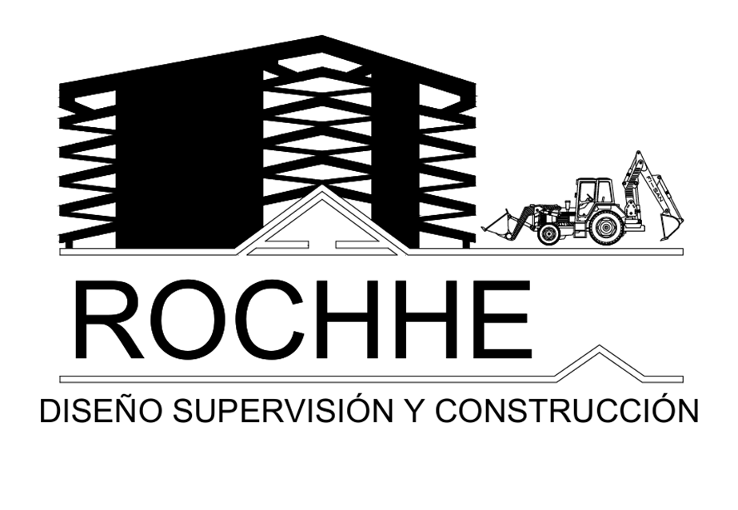
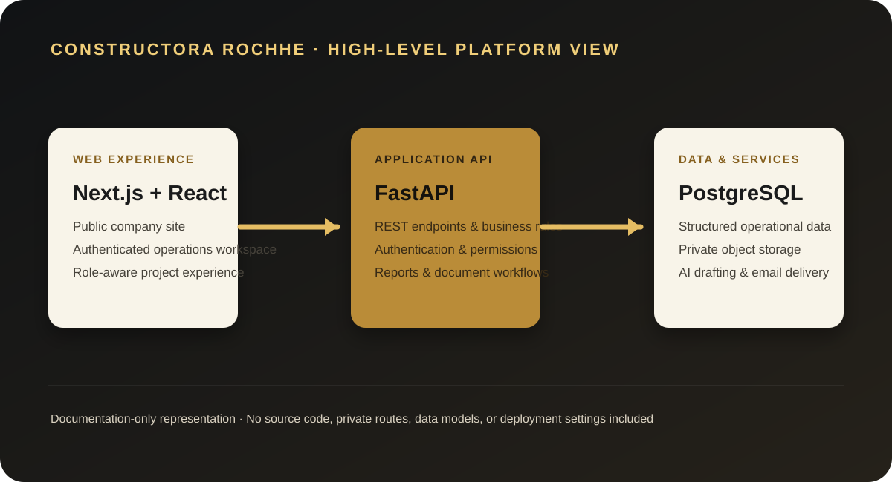

# Constructora Rochhe — Portfolio Case Study

  

  <strong>A full-stack operations platform for construction-project planning, control, and reporting.</strong> 
  Portfolio case study · Source code remains private

  
  
  
  
  
  

---

## Overview

Constructora Rochhe is a web platform built to centralize the operational lifecycle of construction projects. It connects planning, budgets, unit-price analysis, schedules, field records, costs, equipment, and reporting in one role-aware workspace.

The product replaces disconnected spreadsheets and manual follow-up with structured workflows designed around the day-to-day reality of project teams.

> This is a documentation-only portfolio edition. It contains no application source code, production data, credentials, private files, database structure, or deployment configuration.

## Product areas

| Area | What it supports |
| --- | --- |
| Project operations | Project profile, team assignment, location, lifecycle status, archive and restore flows |
| Budgets & unit-price analysis | Line items, resource catalogues, materials, labor, equipment, direct and indirect cost calculations, and versions |
| Scheduling | Task planning, periods, financial flow, physical progress, schedule tracking, and Gantt export |
| Field records | Daily work logs, personnel, equipment, progress, incidents, and private photo evidence |
| Cost control | Cost periods, expenses by work item, suppliers, advances, and budget comparison |
| Reporting | Operational Excel/PDF exports and editable Word/PDF reports |
| Administration | People, employees, users, roles, permissions, clients, suppliers, and reference catalogues |
| Public website | Company presentation, project portfolio, and contact workflow |

## Engineering contribution

I designed and developed the platform end-to-end as a full-stack project, from the public-facing experience through the authenticated operations workspace and API layer.

Key areas of work included the project workspace, budget and APU workflows, scheduling, digital field records, cost controls, role-based access, administrative catalogues, reporting, file handling, and AI-assisted report drafting.

## Architecture at a glance

  

| Layer | Approach |
| --- | --- |
| Web client | Next.js App Router, React, TypeScript, Tailwind CSS, and motion primitives |
| Application API | FastAPI, SQLModel, SQLAlchemy, Pydantic, and modular REST endpoints |
| Data | PostgreSQL with versioned migrations and validated data models |
| Access control | JWT sessions in `httpOnly` cookies, configurable RBAC, and project-level scope |
| Private media | Controlled object storage with short-lived signed access for evidence files |
| Documents & intelligence | PDF, Word, and spreadsheet generation; controlled AI-assisted report drafting |

## Representative workflows

### From estimate to controlled execution

1. Create a project and define its operational profile.
2. Build budget line items and unit-price analyses from reusable resource catalogues.
3. Plan the schedule and relate work items to planned activity.
4. Record daily progress, personnel, equipment, incidents, and evidence.
5. Compare expenses and execution progress against the planned budget and schedule.

### Permission-aware project operations

1. An administrator defines users, roles, and permissions.
2. Users receive access only to the modules and projects assigned to them.
3. The interface and API both enforce the permitted scope.
4. Teams work from a shared operational record while private evidence remains protected.

## Technical decisions

- **One visible origin for the browser:** the Next.js client proxies API traffic, preserving secure cookie-based authentication without exposing separate browser-facing origins.
- **Configurable authorization:** permissions are data-driven instead of hard-coded, with an additional project-access layer.
- **Traceable budget workflows:** unit-price analysis separates resources into material, labor, and equipment cost divisions while preserving versioned budget context.
- **Private evidence by design:** operational photographs and documents use protected storage instead of public file URLs.
- **Practical reporting:** operational data can be exported to formats teams already use, while AI assistance is constrained by validation and consumption controls.

## Quality and security focus

- Typed frontend and backend contracts.
- Automated frontend, backend, and calculation-focused tests in the private repository.
- Schema migrations and repeatable catalogue setup for predictable environments.
- Password hashing, JWT session protection, login-attempt limits, and permission checks.
- Validation of uploaded evidence by content type and size.
- Secrets and external-service credentials kept outside version control.

## Screenshot gallery

The gallery is intentionally prepared for sanitized product evidence. Screenshots will be added here without publishing the application itself.

| Planned view | What it will demonstrate |
| --- | --- |
| `01-dashboard.webp` | Operational overview and role-aware navigation |
| `02-project-overview.webp` | Project context, status, and team information |
| `03-apu-budget.webp` | Unit-price analysis and budget composition |
| `04-schedule.webp` | Planning and schedule visualization |
| `05-field-log.webp` | Daily field-record workflow |
| `06-cost-control.webp` | Expense and budget-control experience |
| `07-reports.webp` | Reporting and export capabilities |

See [`assets/screenshots/README.md`](assets/screenshots/README.md) for the sanitization checklist.

## Private source-code notice

The complete source code, technical documentation, database design, test suite, deployment configuration, and operational assets are intentionally private. They can be discussed or reviewed with legitimate evaluators when appropriate.

This public repository is intended to demonstrate product scope, engineering approach, and professional experience—not to distribute the application.

## Rights

Copyright © Oscar Chitay. All rights reserved.

No license is granted to copy, use, modify, redistribute, or deploy the platform or any related materials.
